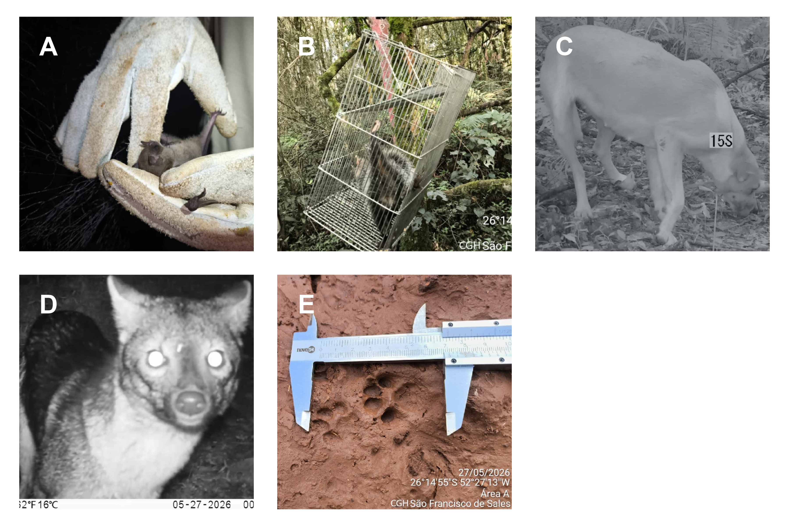
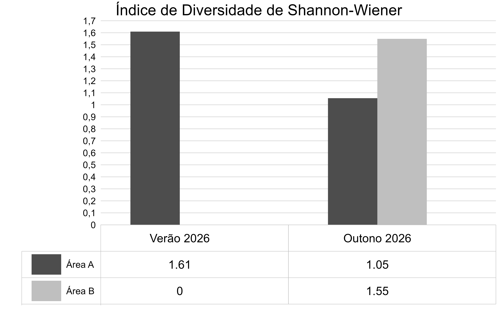
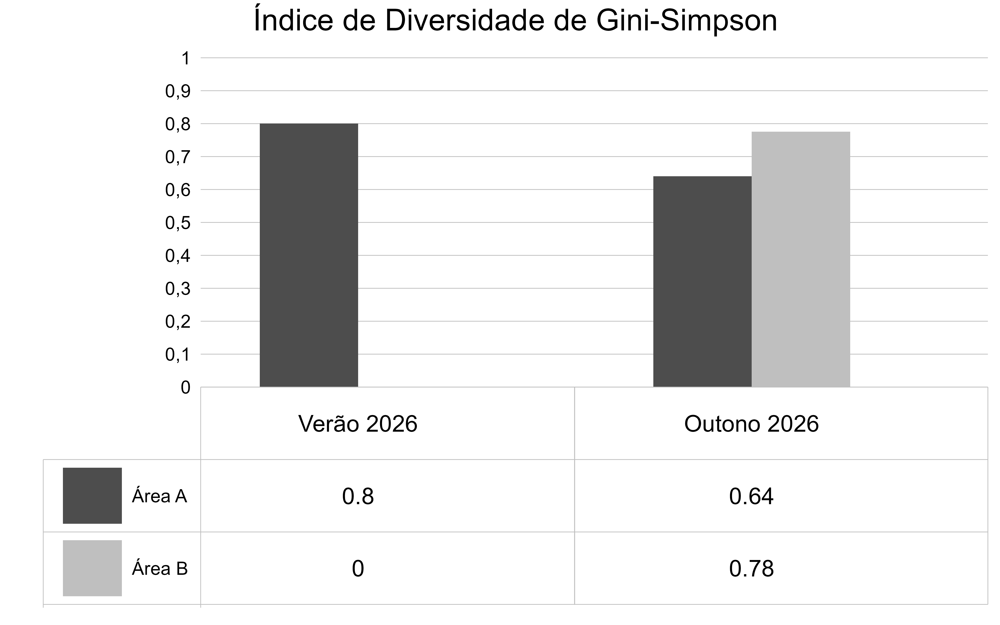
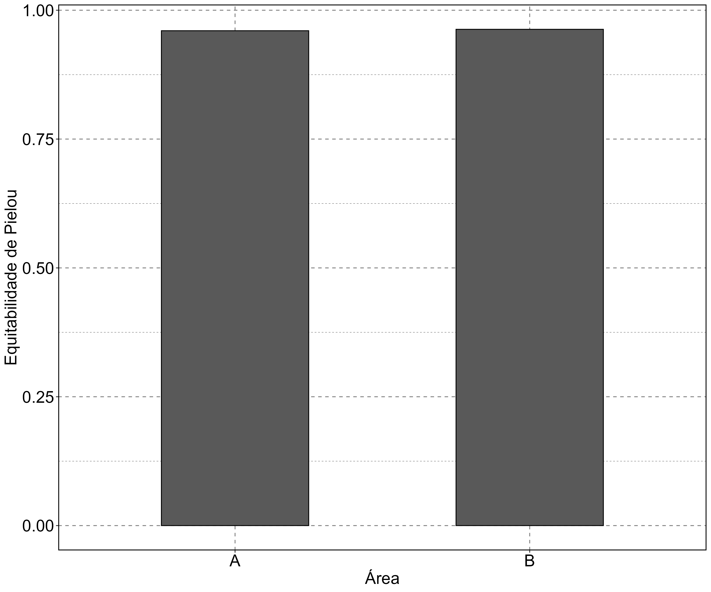

# 4.3. Mastofauna

Mamíferos são vertebrados terrestres vitais na estruturação de diversas comunidades e ecossistemas [@Robinson1986; @Vale2023], atuando em diversos nichos ecológicos distintos e sendo vitais para diversos serviços ecossistêmicos [@Costa2000; @Asfora2009]. O Brasil abriga uma ampla variedade de espécies mamíferos, sendo contabilizados atualmente cerca de 790 espécies, sendo 777 espécies nativas e 13 espécies exóticas [@Abreu2025]. No estado do Paraná, são registrados 166 espécies de mamíferos, distribuidas em 17 espécies como criticamente ameaçadas (CR), cinco como Em Perigo (EN) e 11 como vulneráveis (VU) [@Tiepolo2025]. Fora das categorias de ameaça, foram registradas 10 espécies como Quase Ameaçadas (NT), 69 como Fora de Perigo (LC) e 54 como Deficientes de Dados (DD).

Devido ao fato de que diversas espécies de mamíferos atuam como espécies chaves em diversos ecossistemas, sendo muitas vezes meso e topo predadores, estes animais são bioindicadores de modificações ambientais [@Gama-Matos2020; @Vale2023]. Isto faz que sua amostragem em estudo de impactos ambientais seja de extrema importância para avaliar áreas de prioridade e possíveis impactos ambientais.

Foram realizadas duas campanha de amostragens, abrangendo o verão e o outono de 2026, abrangendo duas áreas, durante 5 dias de amostragem cada. Foram utilizados os métodos de amostragem através de armadilha Sherman iscada, focada em pequenos mamíferos terrestres [@Auricchio2002], o uso de armadilhas fotográficas [@MCCleery2014], a observação de pegadas, revisadas baseadas em @Becker2013 e fezes baseadas em @Prist2020, e o uso de redes de neblina, focada em morcegos [@Kunz2009]. Após a captura das espécies, estas foram identificadas com o auxílio de chaves de identificação, e poisteriomente liberados.

Ao total, foram registradas cinco espécies, distribuidos em quatro famílias (Figura 1, Tabela 1).

## 4.3.1. Espécies Endêmicas

Nenhuma das espécies observadas são endêmicas do estado do Paraná, com as campanhas realizadas até o momento.

## 4.3.2. Espécies Ameaçadas

Das espécies amostradas na campanha, apenas _Leopardos tigrinus_ aparece em algum grau de ameaça, estando classificado como Em Perigo (EN) pela Lista acional de Espécies ameaçadas, e Vulnerável (VU) pela IUCN Red List [@Abreu2025].

## 4.3.3. Espécies Exóticas

Das espécies amostradas, apenas _Canis lupus_ apareceu como espécie exótica, sendo esta o cão-doméstico [@Abreu2025]. Estudos na Mata Atlântica mostraram que _C. lupus_ também pode ser uma espécie com potencial invasor, principalmente para invertebrados de pequeno e médio porte [@Silva2018; @Zanin2019].

## 4.3.4. Espécies de Interesse Socioeconômico

O presente estudo detectou _Sturnira lilium_, _Didelphis albiventris_ e _Canis lupus_ como espécies de interesse socioeconômico. _S. lilium_ é uma espécie frugívora, sendo uma importante dispersora de sementes em ambientes da Mata Atlântica [@Mello2008]. _D. albiventris_ é uma espécie de conhecida por ser predadora de invertebrados com potencial perigo a seres humanos, como escorpiões, e é conhecido seu potencial como dispersor de sementes [@Cantor2010; @DaSilva2014]. _C. lupus_ é uma das espécies mais usadas como pet no brasil, sendo muito usada como guarda e pastoreio em ambientes rurais, próximos à ambientes florestais.

## 4.3.5. Espécies Bioindicadoras

Ao longo da campanha de amostragem, foram detectados _Sturnira lilium_, _Cerdocyon thous_ e _Leopardus tigrinus_. Por _S. lilium_ ser uma espécie frugívora de plantas nativas da Mata Atlântica, sua presença indica áreas com um maior grau de preservação e regeneração [@Mello2008]. Além disto, estudos apontam que populações de _S. lilium_ sofrem assimetria morfológica em ambientes urbanos [@DeFigueiredoRamalho2015]. _C. thous_ é uma espécie principalmente encontrada em ambientes florestais, onde sua presença indica áreas mais bem preservadas e com ambientes de centro de mata mais estáveis [@Santos2024; @Santana2026]. _L. tigrinus_ também é uma espécie com alta preferência por ambientes florestais, onde sua maior presença é um indicativo de ambientes e teias tróficas mais estáveis ou em estado de regeneração ambiental mais avançado, sendo cophecida sua preferência por áreas com menos conflitos com humanos [@Oliveira-Santos2012; @Cepeda-Duque2023]

## 4.3.6. Espécies Ripícolas

Ao longo da campanha de amostragem, não foi registrada nenhuma espécie ripícola.

## 4.3.7. Suficiência Amostral e Riqueza

As amostragens detectaram 8 espécies ao todo, distribuídas em 6 espécies na Área A e 2 novas espécies na área B espécies na Área B. O estimador de Bootstrap [@Smith1984] (Figura 2) estimou 9 espécies, mas sem previsão de estabilização, indicando pouca complementariedade das amostragens. Com base nos resultados obtidos, não foi observado que a amostragem contemplou a totalidade das espécies de mamíferos da região. Isto pode ser explicado pela baixa quantidade de áreas anaplisadas (2) e o período menos contemplativo da estação (5 dias). Estes resultados mostaram que o esforço amostral não foi adequado o bastante para detectar a totalidade espécies da região. 

Para a metrificação da diversidade das espécuies detectadas, foi usada uma comparação dos índices de Shannon-Wiener, Gini-Siumpson e Equitabilidade de Pielou. O índice de Shannon-Wiener explica o grau de incerteza de um indivíduo detectado pertencer a uma espécie em espécifico, cujo o aumento da incerteza representa maiores valores de diversidade, pois maiores diversidade de comunidades são representadas por espécies com abundâncias semelhantes [@Shannon1948]. Já o índice de Gini-Simpson é um índice que mede a chance de dois indinvíduos detectados aleatoriamente poderem ser de espécies distintas, variando de 0 (a comunidade apresenta apenas uma única espécie) a 1 (todas as espécies da comunidade apresentam a mesma abundância e chances de os indivíduos serem de espécies distintas)  [@Simpson1949]. Por fim, o índice de Equitabilidade de Pielou mede as chances que suas espécies dioferentes de forma aleatória serem detctados ao acaso em uma amostragem, variando de 0 (a comunidade só tem uma única espécie) a 1 (todas as espécies apresentam as mesmas chances de serem detectadas, pois apresentam as mesmas abundâncias) [@Pielou1966]. Os valores do índice de diversidade de Shannon-Wiener (Figura 3 & Equação 2), Gini-Simpson (Figura 4 & Equação 3) e Pielou (Figur 5 & Equação 4) para as áreas A e B foram 1,05 e 1,55, 0,64 e 0,78 e 0,96 e 0,963, respectivamente, indicando que a área B apresentou maior diversidade que a área A para os três índices. 

::: {#eq-shannon}

$$H' = - \sum_{ì = 1}^{S}{p_i * \ln{p_i}}$$

Equação 2. Descrição do índice de diversidade Shannon-Wiener. $p_{i}$ = abundância relativa da espécie $_i$. $\ln$ = logarítimo natural.
:::

::: {#eq-simpson}

$$D = \sum_{ì = 1}^{S}{p_i^2}$$

Equação 3. Descrição do índice de diversidade Gini-Simpson. $p_{i}$ = abundância relativa da espécie $_i$.
:::

::: {#eq-pielou}

$$J = \frac{H´}{\ln{\left(S\right)}}$$

Equação 4. Descrição do índice de equitabilidade de Pielou. $H'$ = índice de Shannon-Wiener. $\ln$ = logarítimo natural. $S$ = riqueza de espécies.
:::

## 4.3.8. Considerações Finais

A curva do coletor feita indica que a amostragem realizada nas áreas não foi o suficiente parar detectar a diversidade de espécies de mamíferos potenciamente presentes na área. É recomendado que sejam feitas campanhas posteriores de amostragem, com maior abrangência temporal e espacial, a fim de detectar espécies com detectabilidade ocasional, especialmente raras e difíceis de serem amostradas em campnhas menores. Esta recomendação se basea no fato que é importante uma amostragem que detecte o máximo de espécies, sobretudo as espécies mais raras e ocasionais, a fim de melhor descrever a mastofauna da região.

A área B apresentou mais igualdade da distribuição de abundância de espécies, refletido nos maiores valores de diversidade de espécies [@Jost2006]. Estes resultados podem ser um reflexo não apenas da maior área da área B, quanto também do seu estado de conservação. Isso foi refletido pela presença de _Cerdocyon thous_ e _Leopardus tigrinus_, espécies conhecidas por ocorrerem em áreas mais preservadas [@Races2010; @Trigo2013].

Estes resultados são indicativo da importância de monitoramentos constantes, abrangendo uma maior escala temporal e espacial, a fim detectar espécies raras e de nichos não amostrados.

# Referências biblioráficas:

::: {#refs}
:::
